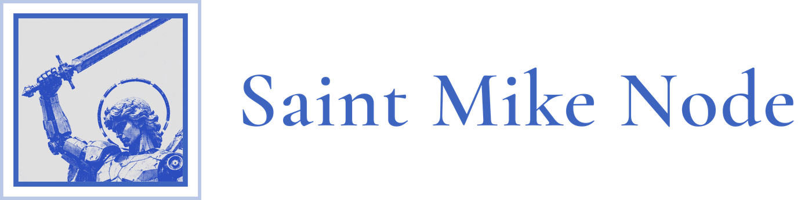

  <picture>
    <source media="(prefers-color-scheme: dark)" srcset="https://raw.githubusercontent.com/SaintMikeNode/.github/main/profile/saint-mike-node-banner-dark.png">
    
  </picture>

<b>Learn, build, share.</b> A community for people who create with technology, from the heart of Honduras.

<a href="https://saintmikenode.org">saintmikenode.org</a> · Tegucigalpa, Honduras · <i>Quis ut Deus?</i>

---

Saint Mike Node is a community of builders and creators born in Tegucigalpa: people who make things with computers and technology, whether that means coding, designing, animating, or exploring with AI. Any language, any tool: from old-school coders to vibe coders and the simply curious.

We are at the dawn of artificial intelligence, and what gets learned and built today will decide who benefits tomorrow. That knowledge shouldn't stay in a few hands, so we share it openly.

### What we do

- **Builder meetups**: show what you're working on, in the spirit of the old computer clubs.
- **Workshops**: hands-on sessions to learn a tool, a language, or a technique.
- **Hackathons**: form a team and build something from start to finish.
- **Mentorship**: pairing people starting out with people who have walked the road.

### Projects

- **[Todos en la Web](https://todosenlaweb.com)**: free websites for small businesses with social impact, built by the community. Repos start with `tel-`.

---

Named after Saint Michael the Archangel, patron of Tegucigalpa: a tribute to the city, regardless of belief.
